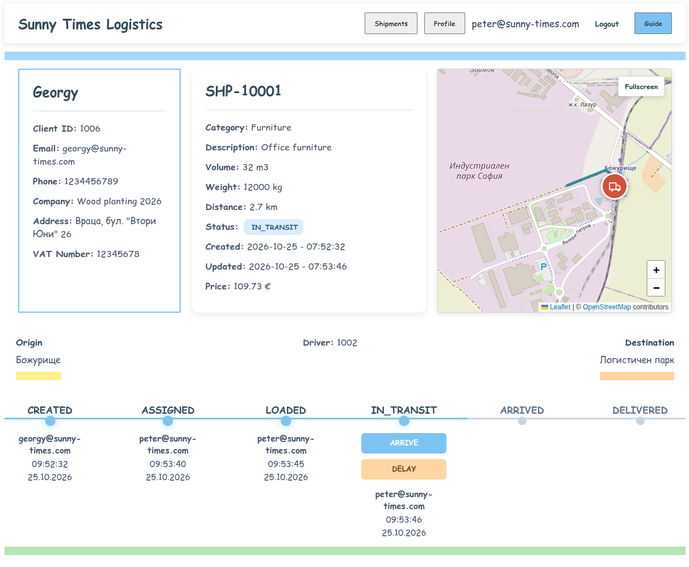
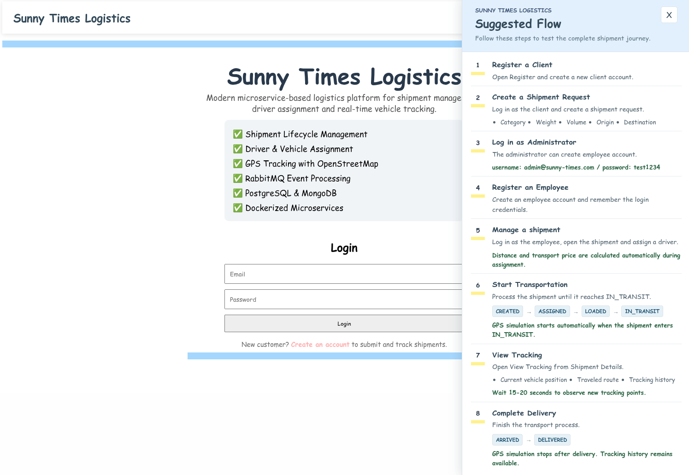
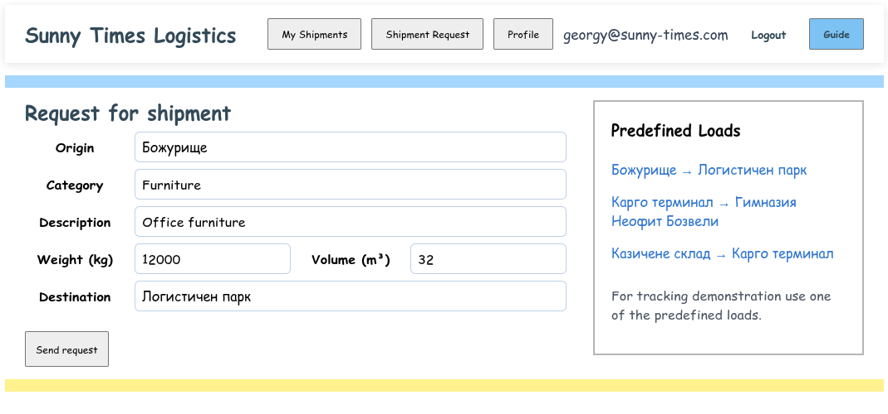
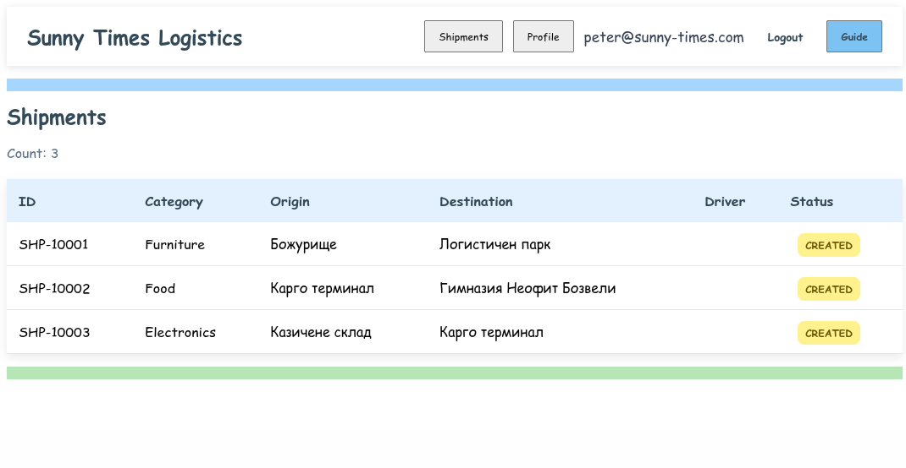
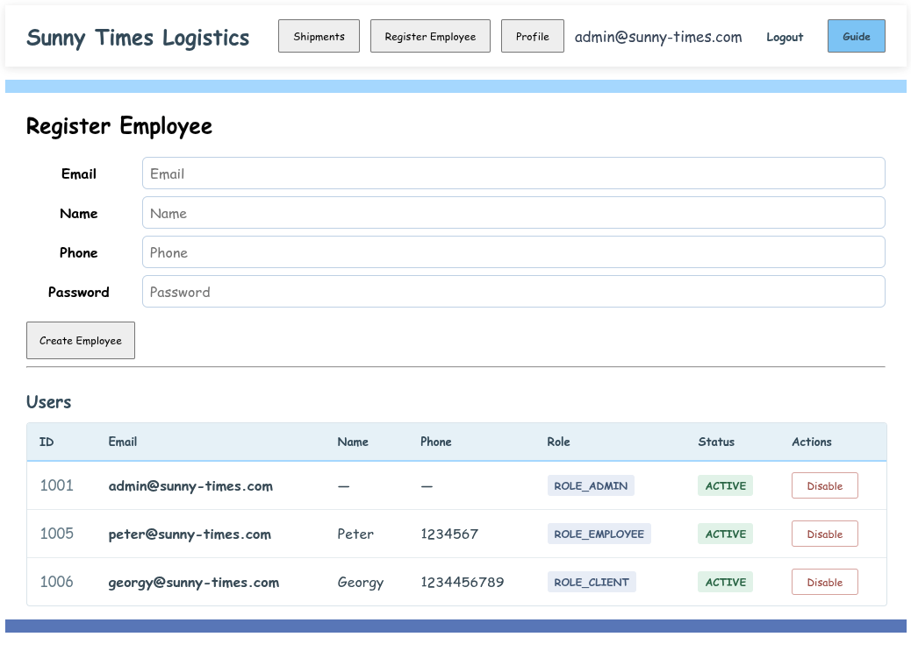

# Sunny Times Logistics



A microservice-based logistics application for shipment requests and processing, user and driver management, and vehicle tracking. The project includes Spring Boot services, an Angular frontend, and a Docker Compose setup for local use.

## Highlights

- Role-based workflows for clients, employees and administrators
- Shipment processing with driver/vehicle assignment, distance-based pricing and status history
- Event-driven GPS ingestion through RabbitMQ, with tracking history stored in MongoDB
- Interactive vehicle map showing current position and traveled path
- Docker Compose setup that runs the application and its supporting infrastructure locally

## Screenshots

### Login and Demo Guide



Landing page with integrated Demo Guide describing the complete shipment lifecycle.

### Client Shipment Request



Clients can submit shipment requests by providing shipment details including origin, destination, weight and volume.

### Shipment List



Employees can review and manage shipments across the system.

### Shipment Management and Tracking


Employees assign drivers, track shipment progress, review shipment history, and monitor vehicle location on an OpenStreetMap map.

### Administration



Administrators can register employees, manage users and enable or disable accounts.

## Architecture

| Component | Responsibility |
|----------|----------------|
| `authentication-service` | Registration, login, JWT access/refresh tokens, profiles, user status and token validation |
| `common-service` | Client and driver reference data |
| `shipment-service` | Client shipment requests, operational shipment management, driver/vehicle assignment, pricing, workflow and status history |
| `tracking-api` | Validates GPS events and publishes them to RabbitMQ |
| `tracking-service` | Consumes GPS events, stores locations in MongoDB, and serves tracking history and latest positions |
| `mock-gps-tracker` | Simulates vehicle movement and sends GPS points to `tracking-api` |
| `frontend` | Angular application for clients, employees and administrators; includes a Leaflet/OpenStreetMap tracking map |
| `api-contracts` | Shared request, response and event types |
| `shared-security` | Shared JWT and security components |

Tracking data flow:

```text
mock-gps-tracker
       ↓
tracking-api
       ↓ publishes GPS events
RabbitMQ
       ↓ consumes events
tracking-service
       ↓
MongoDB
       ↓
Leaflet / OpenStreetMap vehicle map
```

The map shows the vehicle's current position, traveled path and tracking history. Latest-position data is polled while tracking is active; this is not WebSocket-based live streaming or road-route planning.

## User Workflows

### Client

Clients register, complete their profile, submit shipment requests and view their own shipments. A complete profile is required before submitting a request. Operational shipment creation and processing are handled by employees and administrators.

### Employee

Employees view and manage shipments, assign drivers and vehicles, and process shipment workflow events. The system calculates route distance and shipment price. GPS simulation starts when the shipment departs and stops when delivery is completed.

### Administrator

Administrators manage users, create employee accounts, and enable or disable accounts. They can also access shipment operations.

### Shipment workflow

```text
CREATED → ASSIGNED → LOADED → IN_TRANSIT → ARRIVED → DELIVERED
```

`DELAYED` and `CANCELLED` are additional shipment statuses.

## Demo Scenario
1. Open **Register** and create a client account.
2. Sign in as the client and create a shipment request with category, weight, volume, origin and destination.
3. Sign in as the administrator (`admin@sunny-times.com` / `test1234`, if these are the credentials configured for the deployment) and open **Register Employee**.
4. Create an employee account and note its login credentials.
5. Sign in as the employee, open the shipment and assign an available driver. Distance and transport price are calculated automatically during assignment.
6. Process the shipment until it reaches `IN_TRANSIT`:

       ```text
       CREATED → ASSIGNED → LOADED → IN_TRANSIT
       ```

       GPS simulation starts automatically when the shipment enters `IN_TRANSIT`.
7. Open **View Tracking** from Shipment Details. Review the current vehicle position, traveled route and tracking history. Wait 15–20 seconds to observe new tracking points.
8. Complete delivery:

       ```text
       ARRIVED → DELIVERED
       ```

       GPS simulation stops after delivery, while the tracking history remains available.

## Technology and Data Stores

- Java 21, Spring Boot, Spring Security and Spring Data
- Angular, TypeScript and Leaflet
- PostgreSQL for authentication, common and shipment data
- MongoDB for tracking locations
- RabbitMQ for GPS event delivery
- Docker and Docker Compose

## Run with Docker Compose

Prerequisites: Docker Engine and the Docker Compose plugin.

From the repository root, build and start the full application:

```bash
docker compose up --build
```

To run it in the background:

```bash
docker compose up --build -d
```

Open the frontend at <http://localhost:4200>. The default demo administrator is `admin@sunny-times.com` with password `test1234`. Set `AUTH_ADMIN_EMAIL` and `AUTH_ADMIN_PASSWORD` to override these values. The seeder creates the admin only when that email is not already present in the database; existing database volumes retain their users and data.

Stop the application with `docker compose down`. This keeps database volumes. To remove the containers and their persisted data, use `docker compose down -v`.

Compose supplies development defaults for database credentials and JWT secrets. These defaults are for local demonstration only; replace them and restrict network access before any shared or production deployment. The Compose file publishes service and database ports on the host.

### Optional Compose environment file

The repository does not include a `.env` file; it is ignored by Git. Compose can run with its built-in defaults. To override settings, create a root `.env` file with `KEY=value` entries. Common variables include:

```dotenv
ALLOWED_ORIGINS=http://localhost:4200
AUTH_ADMIN_EMAIL=admin@sunny-times.com
AUTH_ADMIN_PASSWORD=change-this-demo-password
AUTH_DB_USERNAME=authentication
AUTH_DB_PASSWORD=change-this-database-password
COMMON_DB_USERNAME=common
COMMON_DB_PASSWORD=change-this-database-password
SHIPMENT_DB_USERNAME=shipment
SHIPMENT_DB_PASSWORD=change-this-database-password
TRACKING_MONGODB_DATABASE=trackingdb
TRACKING_API_RABBITMQ_USERNAME=rabbit
TRACKING_API_RABBITMQ_PASSWORD=change-this-rabbitmq-password
TRACKING_RABBITMQ_USERNAME=rabbit
TRACKING_RABBITMQ_PASSWORD=change-this-rabbitmq-password
```

Do not commit real credentials or secrets. Compose reads the file automatically; it does not need to be sourced into the shell.

## Local Development

### Prerequisites

- Java 21 and Maven
- Node.js 22 and npm
- Docker and Docker Compose for local databases and RabbitMQ

The simplest local development setup is to run infrastructure and backend services with Compose, then run Angular using its development server:

```bash
docker compose up --build -d
docker compose stop frontend
cd frontend
npm ci
npm start
```

The frontend development server uses the same `http://localhost` API addresses as the Docker-hosted services. Open <http://localhost:4200>. The Compose frontend container is stopped to free that port.

To run Spring services directly from Maven instead, build the shared modules first:

```bash
mvn -f api-contracts/pom.xml -DskipTests install
mvn -f shared-security/pom.xml -DskipTests install
```

Then start each service from its module directory with `mvn spring-boot:run`. Provide the environment variables referenced by that service's `src/main/resources/application.yaml`; Compose does not export its `.env` values into separately launched Maven processes. Local Java processes need host database and RabbitMQ addresses, and the services' inter-service URLs must point to `localhost` rather than Compose service names. The corresponding infrastructure ports are listed below.

## Default Ports

| Component | Host port |
|----------|-----------|
| Frontend | 4200 |
| Authentication service | 8080 |
| Common service | 8081 |
| Shipment service | 8082 |
| Tracking API | 8083 |
| Tracking service | 8084 |
| Mock GPS tracker | 3001 |
| PostgreSQL shipment | 5432 |
| PostgreSQL authentication | 5433 |
| PostgreSQL common | 5434 |
| MongoDB tracking | 27017 |
| RabbitMQ | 5672 |
| RabbitMQ management UI | 15672 |

## Deployment Status

Docker Compose is configured for local development and demonstration. An AWS production deployment is not documented or provisioned by this repository. The frontend currently targets `localhost` API URLs, and the default CORS origin is `http://localhost:4200`; a remote deployment requires environment-specific API addressing, CORS configuration, secrets management, network restrictions and infrastructure setup. Do not use the Compose defaults as production settings.

## Current Features

- Role-based authentication, JWT refresh, profile management and account status controls
- Client shipment requests and shipment listing
- Employee/admin shipment processing, vehicle and driver assignment, pricing and status history
- GPS simulation, RabbitMQ event transport and MongoDB tracking history
- Vehicle position and traveled-path visualization on a Leaflet/OpenStreetMap map
- Docker Compose setup for the full local application

## Project Structure

```text
logistics-system/
├── api-contracts/
├── authentication-service/
├── common-service/
├── shipment-service/
├── tracking-api/
├── tracking-service/
├── mock-gps-tracker/
├── frontend/
├── shared-security/
├── Dockerfile.java
└── docker-compose.yml
```

An optional root `.env` file can override Compose defaults; it is not tracked in the repository.